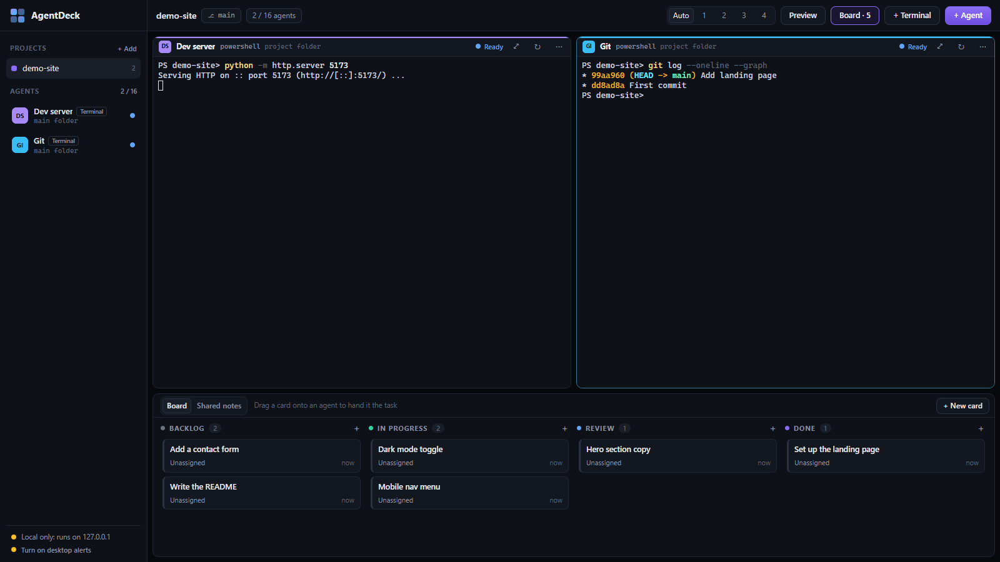

# AgentDeck

Run several Claude Code agents side by side, each in its own terminal pane, and hand them tasks from a Kanban board.
Each agent can work in its own copy of the project (a git worktree on its own branch), so they can work at the
same time without overwriting each other. A Lead agent can split a goal into cards and hand them out, and you
review and merge each agent's branch from inside the app.



- **Local only.** The server listens on `127.0.0.1:4646`. Other websites can't talk to it (Host, Origin and
  custom-header checks).
- **Your Claude Code, as it is.** Agents are ordinary `claude` sessions, signed in the same way as your own Claude Code.
  AgentDeck never changes your global Claude settings or your project files for its own plumbing.
- 1 to 16 panes, status lights, desktop alerts, a shared notes tab, live preview and review/merge.

## Requirements

- Windows 10 or 11 (the terminals use ConPTY and the folder picker is a Windows dialog)
- [Node.js](https://nodejs.org) 20 or newer
- [Claude Code](https://docs.claude.com/en/docs/claude-code) installed and signed in (`claude` on your PATH)
- [Git](https://git-scm.com)
- Chrome or Edge (AgentDeck opens itself in an app window; any browser works at `http://localhost:4646`)

## Run

```bash
git clone https://github.com/mariobilly/agentdeck.git
cd agentdeck
npm install
npm start
```

A console starts the server and an app window opens. Close the window any time and the agents keep running.
**Closing the console stops every agent.** `node server.js --no-open` starts the server without opening a window.

## Use

1. **+ Add** a project: pick one from the list (the subfolders of your projects folder) or **Browse**.
2. If it isn't a git project yet, click **Set up git**. AgentDeck scans the folder and shows what git will
   **save** (your code) and what it will **skip**: dependencies (`node_modules`, `.venv`), caches, build
   output, renders/exports, big code-free folders (models), large media/model/archive files, logs and
   **secrets** (`.env`, keys). Untick anything you want saved. The skip list goes into `.gitignore`, then
   `git init` and a first commit, all local.
3. **+ Agent**: pick a role (Builder, Reviewer, Tester, Lead or Custom), a model and where it works:
   - *Its own copy*: a worktree at `<project>\.agentdeck\worktrees\<name>` on branch `agent/<name>`.
     Skipped folders and files (models, caches, `node_modules`) are **shared into the copy with hard links**:
     the app can run there, it takes no extra disk space, and deleting the copy never deletes the originals.
     Secrets (`.env`, keys) and logs are not shared. Note: editing a shared file *in place* changes the
     original too (agents normally only edit code).
   - *Main folder*: edits the project directly.
4. The first time an agent opens a project, Claude asks whether you trust it: press **↓ then Enter** for
   "Yes". Claude remembers this per project, so later agents won't ask.
5. **+ Terminal** opens a plain PowerShell pane in the project folder (for dev servers, git and so on).

## Board

- **Board** (top bar) shows or hides it. **+ New card** or the **+** on a column adds a task; click a card
  to edit, move or delete it.
- **Drag a card onto an agent's pane** (or onto the agent in the sidebar) to hand it over: the task is
  typed into that agent's Claude as one message, and the card moves to *In progress* with the agent's colour.
  You can also pick "Give it to" in the card dialog.
- Drag cards between columns (and up/down) to keep track. A card can't be sent to a plain terminal, to a
  stopped agent, or while Claude is still asking about trusting the folder.

## Status lights and alerts

Every Claude agent reports what it's doing through Claude Code hooks. AgentDeck passes them with
`--settings data/hooks/<agent>.json` when it starts the agent, so your global Claude settings and your
projects are never changed. The hooks call `curl` (built into Windows) and do nothing if AgentDeck is closed.

| Status | When |
|---|---|
| **Ready** (blue) | Started, waiting for a task |
| **Working** (green, pulsing) | You sent it a prompt or a card |
| **Needs you** (amber) | It asks permission, asks a question, or wants a plan approved. The pane glows, the top bar shows "N needs you" (click it to jump there) and the window title shows "(N) AgentDeck" |
| **Finished** (green) | It finished its turn. Its *In progress* cards move to **Review** by themselves, with its final message attached |
| **Stopped** (grey) | The process isn't running |

Alerts: a soft chime when an agent needs you. When the AgentDeck window isn't in front, a Windows
notification also appears for "needs you" and "finished" (click it to jump to the agent). Turn these on
with **Turn on desktop alerts** at the bottom of the sidebar.

Each agent's own conversation id is saved, so a restart reopens exactly that conversation, and a new agent
never inherits an old agent's chat. Troubleshooting: `http://localhost:4646/api/hook-log` lists the last events.

## The Lead and shared notes

- Add an agent with the **Lead** role (one per project; it works in the main folder and doesn't write code).
  Tell it a goal in its pane, e.g. *"Add a contact page and a dark mode toggle."* It splits the goal into cards,
  hands each free Builder one card at a time, and keeps the rest in Backlog.
- When an agent finishes a card (or answers the Lead's message), AgentDeck sends the Lead an
  **[AgentDeck update]** with the agent's final message. Updates wait while the Lead is busy or waiting for you,
  so they never land in a permission question. The Lead then assigns the next card, asks a Reviewer/Tester,
  sends a fix request, or tells you everything is in Review. It never merges.
- **Agent tools** (an MCP server, `mcp.js`, given to each agent with `--mcp-config` and pre-approved so they never
  ask permission):

  | Tool | Who | What |
  |---|---|---|
  | `agents` | everyone | the team: role, model, status, branch, current card |
  | `board` | everyone | all cards with ids, columns, assignees and finish summaries |
  | `notes` / `remember` | everyone | read / add shared notes |
  | `create_card` | everyone (assign_to: Lead only) | add a card; the Lead can hand it out immediately |
  | `move_card` | own cards; Lead: any | move between columns |
  | `assign_card`, `message_agent` | Lead only | hand a card to a free agent / send a follow-up (its reply comes back as an update) |

- **Shared notes** (tab next to Board): facts and rules every agent reads before a task, e.g. *"Stripe amounts are
  in cents"*. Agents add their own with `remember`; you can add or delete notes there too.

## Review, merge and live preview

- Agents with their own copy show **"N to merge"** (sidebar) and a **Merge ↑N** button (pane header) when their branch
  has commits main doesn't. Open **Review & merge** from there, from a card's dialog, or from the pane's ⋯ menu.
- The review window shows the commits, every changed file (new / changed / deleted, +/− lines) and the full colored
  diff. It warns when the copy has uncommitted changes and when the copy is behind main (with a one-click "update its copy").
- **Merge into main** runs `git merge --no-ff` in the main folder:
  - If two agents changed the same lines, the merge is **cancelled immediately** (`git merge --abort`); main is never
    left half-merged. **Ask <agent> to fix the clash** sends it back to merge main into its copy, resolve, commit
    and reply; then merge again.
  - If the main folder has uncommitted changes, nothing happens until you choose to save them as their own commit first.
  - After a merge: the agent's Review cards move to **Done**, the Lead is told, and every idle copy with no unsaved
    changes is updated from main.
- **Send back with feedback** types your feedback into the agent and moves its cards back to In progress.
- **Preview** (top bar) opens a side panel showing the site from the **main folder**, any **agent's copy**, or a
  **dev server URL** (e.g. `http://localhost:5173`). The preview is served on its own port (`4647`), read-only, never
  serves dot-files (`.env`, `.git`), and a page shown there can't reach AgentDeck's controls.

## Panes

⤢ full size (or double-click the header), ↻ restart, ⋯ for *Restart with a new conversation*, *Stop*,
*Copy folder path* and *Remove*. Removing can also delete the agent's copy and branch, but only if its work is
committed. A branch with unmerged work is always kept. Right-click a project to remove it from the list
(nothing is deleted from disk).

Keys in a pane: Ctrl+C copies when text is selected (otherwise it interrupts), Ctrl+V pastes,
Shift+Enter adds a new line in Claude. Dictation tools that paste text (like
[Whisper Push-to-Talk](https://github.com/mariobilly/whisper-push-to-talk)) work in panes too.

## Settings

Environment variables, all optional:

| Variable | Default | What it does |
|---|---|---|
| `AGENTDECK_PORT` | `4646` | UI port (the preview uses the next port up) |
| `AGENTDECK_PROJECTS_DIR` | the folder AgentDeck is in | Folder whose subfolders are listed under **+ Add** |
| `AGENTDECK_DATA` | `./data` | Where projects, agents, cards and per-agent configs are saved |
| `AGENTDECK_BLOCK_API_KEYS` | off | Set to `1` to strip AI-provider API keys (Anthropic, OpenAI, Google) from every agent's environment, so agents can only use your Claude Code sign-in and nothing bills an API key by accident |

## Files

- `server.js`: Node server (http + WebSocket), terminals via `@lydell/node-pty`, git worktrees, board, git setup.
- `public/`: the UI (xterm.js terminals, no build step).
- `mcp.js`: the agents' AgentDeck tools (MCP over stdio, no dependencies), forwarding to `/api/mcp/...`.
- `pick-folder.ps1`: the Windows folder picker for **Browse**.
- `data/` (created on first run): `state.json` (projects, agents, cards, layout) and the per-agent `--settings`
  and `--mcp-config` files.

## License

[MIT](LICENSE)
